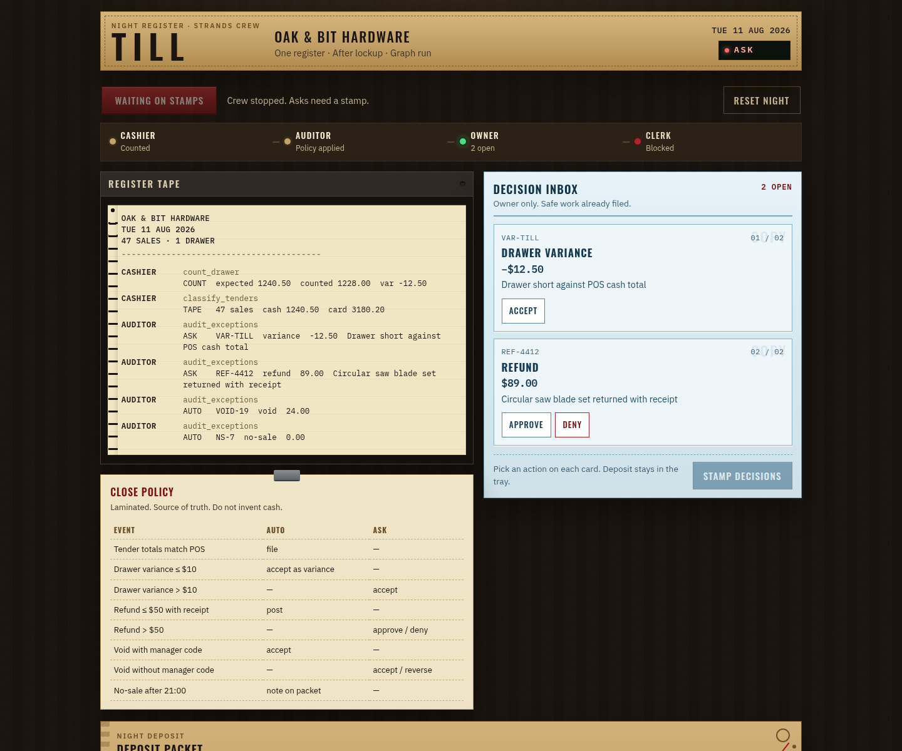
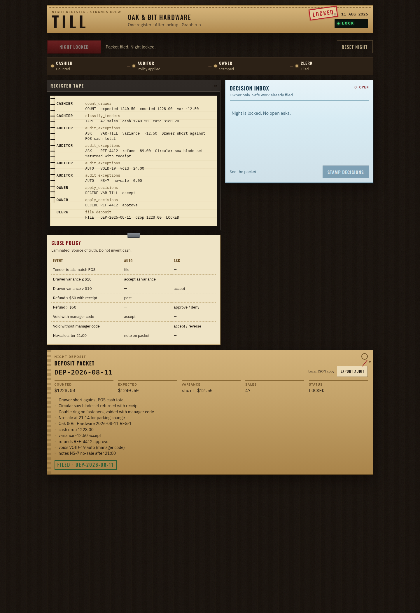

# Till

**Agents for Humans · Professional Agents**

Dana Reyes closes Oak & Bit Hardware alone. Till staffs a night crew from skill files. The cashier counts. The auditor applies policy. The clerk files the deposit. Dana only sees cards the policy cannot close.

This is not a chat box. It is a close.

Till uses the Strands Agents SDK as a policy-constrained graph: each role is a real graph node,
the owner gate is a real `BeforeNodeCallEvent` interrupt, and the clerk cannot run while a
decision remains open. The local path deliberately uses deterministic `MultiAgentBase` nodes so
the close is reproducible and no model is allowed to decide what happens to cash.

## Demo (5 minutes)

```bash
python3 -m venv .venv
source .venv/bin/activate
pip install -r requirements.txt
uvicorn till.main:app --reload --port 8000
```

Open http://127.0.0.1:8000

1. **Run night close**
2. Tape prints cashier + auditor lines. Two cards: `$12.50` short, `$89` refund.
3. Accept the variance. Approve the refund.
4. Packet `DEP-2026-08-11` files. Night stamps **LOCKED**.
5. Click **Export audit** to save the locked close as a local JSON record. It never uploads.

No AWS or model key is required for the judge path. The graph is real Strands
(`GraphBuilder`, `MultiAgentBase`, `BeforeNodeCallEvent`, interrupt/resume).

```bash
pytest tests/test_close.py -q
```

## Why this crew

| Role | Skill | Work |
| --- | --- | --- |
| Cashier | `skills/cashier/SKILL.md` | Count drawer, classify tenders |
| Auditor | `skills/auditor/SKILL.md` | Auto vs ask |
| Owner gate | `skills/owner-gate/SKILL.md` | Interrupt |
| Clerk | `skills/clerk/SKILL.md` | File packet only when inbox is empty |

Policy lives in one place: `till/policy.py`.

## Why this is an agent

Each crew role has a job contract in `skills/<role>/SKILL.md`, executes as a Strands graph node,
and calls tools against the night state. The graph carries the work from counting to audit to a
human interrupt to filing; it is not a collection of disconnected rule checks or a chat prompt.
The executor is deterministic by design because cash policy is a high-consequence boundary. A
future model can narrate or summarize the work, but it must not replace the policy table or the
owner gate.

## Architecture

See the [architecture source](docs/architecture.md) and the rendered
[architecture diagram](docs/architecture.png).

## The judge-visible states

The board starts with no open asks. After the crew runs, the owner sees only the two exceptions
that policy cannot close; the clerk is visibly blocked. After both decisions are stamped, the
same graph resumes and files `DEP-2026-08-11`.





## What is intentionally bounded

The seeded Tuesday is synthetic and runs in one process. Till does not connect to a real POS,
move real money, or claim a hosted deployment. The code proves the complete policy and human-
decision flow locally; live POS integration, multi-user persistence, model narration, and
AgentCore deployment are separate follow-up paths. The audit export is a local download from the
same process, not durable cloud storage. The scenario does not claim measured customer time
savings or user-study results.

## Restart later

Start at [HANDOFF.md](HANDOFF.md). Then:

- [docs/STATUS.md](docs/STATUS.md) — what works
- [docs/DEMO.md](docs/DEMO.md) — video script
- [docs/API.md](docs/API.md) — HTTP
- [docs/DECISIONS.md](docs/DECISIONS.md) — why this product
- [docs/WIN-CHECKLIST.md](docs/WIN-CHECKLIST.md) — Devpost / AgentCore / blogs still open
- [HACKATHON.md](HACKATHON.md) — event context and judging criteria

## License

Apache-2.0
